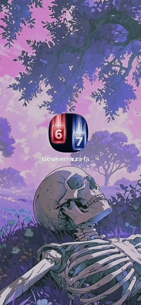

# 🎮 Gameplay

# Six Seven: Aura Farming

Six Seven: Aura Farming é um jogo mobile de ritmo com estética cyberpunk e uma temática inspirada na cultura dos memes e na obsessão por farmar aura. Em duas pistas, o jogador precisa acertar as notas no ritmo da música, testar seus reflexos e superar cada desafio. O objetivo é alcançar pelo menos 51% de acertos para sobreviver à fase, conquistar estrelas para desbloquear novos níveis e, finalmente, atingir os lendários 100% de precisão para receber o selo SIX SEVEN, símbolo máximo de um verdadeiro farmador de aura.

# UNWAKE Studio

A UNWAKE Studio é um estúdio independente recém-criado, idealizado para desenvolver jogos autorais de diferentes gêneros, estilos e propostas. Seu objetivo é explorar ideias criativas, experimentar novas possibilidades e transformar conceitos originais em experiências interativas únicas. Six Seven: Aura Farming representa um dos primeiros passos dessa jornada, marcando o início de um projeto que busca ir além de um único estilo de jogo.

## ACESSE A WIKI PARA MAIS INFORMAÇÕES
### https://github.com/O-Gui/six-seven-aura-farming/wiki

## ACESSE O FIGMA
### https://www.figma.com/design/HjVuCk0ACNbUFfKFO1lHem/six-seven-aura-farming?node-id=0-1&p=f&t=I2GIxsmbN516s3fa-0

## BAIXE A BUILD NATIVA PARA MOBILE
1. acesse esse link baixo pelo seu celular ou tablet
2. clique nos 3 pontinho ... em ativos e baixe
3. clique em Baixar mesmo assim
4. clique em Mais detalhes
5. clique em Intalar assim mesmo

### https://github.com/O-Gui/six-seven-aura-farming/releases/tag/v1.0.0
